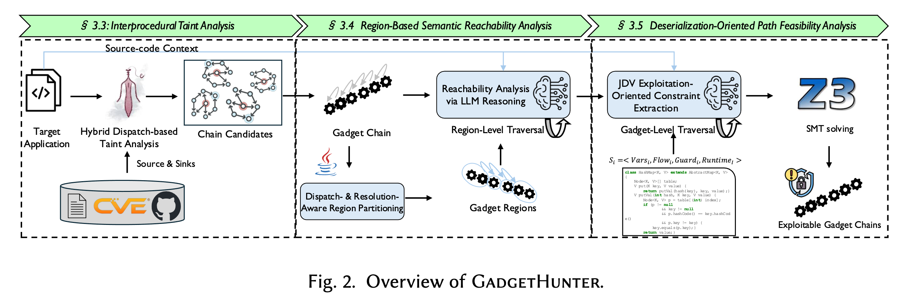

# GadgetHunter [](https://doi.org/10.1145/3797065) [](https://doi.org/10.1145/3797065) [](paper/kaixuan-FSE26_GadgetHunter.pdf) [](LICENSE)

GadgetHunter: Region-Based Neuro-symbolic Detection of Java Deserialization Vulnerabilities

> This branch is the FSE 2026 artifact for reproducing the paper. For the actively developed scanner (no handwritten taint configuration, candidate triage, Spring Boot and WAR inputs, a local web workbench), use the [`modern-scanning`](https://github.com/MarkLee131/GadgetHunter/tree/modern-scanning) branch.

## Paper

> Kaixuan Li, Jian Zhang, Chong Wang, Sen Chen, Zong Cao, Min Zhang, Yang Liu.
> **GadgetHunter: Region-Based Neuro-symbolic Detection of Java Deserialization Vulnerabilities.**
> *Proc. ACM Softw. Eng.* 3, FSE, Article FSE003 (July 2026), 22 pages.
> [doi:10.1145/3797065](https://doi.org/10.1145/3797065)

Preprint version is vendored [**here**](paper/kaixuan-FSE26_GadgetHunter.pdf).

<details><summary>BibTeX</summary>

```bibtex
@article{li2026gadgethunter,
  author    = {Li, Kaixuan and Zhang, Jian and Wang, Chong and Chen, Sen and
               Cao, Zong and Zhang, Min and Liu, Yang},
  title     = {{GadgetHunter}: Region-Based Neuro-symbolic Detection of
               {Java} Deserialization Vulnerabilities},
  journal   = {Proc. ACM Softw. Eng.},
  volume    = {3},
  number    = {FSE},
  articleno = {FSE003},
  numpages  = {22},
  year      = {2026},
  month     = jul,
  publisher = {Association for Computing Machinery},
  doi       = {10.1145/3797065}
}
```

</details>

## Overview

GadgetHunter detects Java deserialization gadget chains in three stages:

1. **Stage 1 — Static taint analysis** (Tai-e) over-approximates candidate chains.
2. **Stage 2 — Region-based semantic reachability** partitions each chain at dynamic boundaries (reflection, polymorphic dispatch) and queries an LLM oracle.
3. **Stage 3 — Path feasibility** lifts each surviving chain to ⟨Vars, Flow, Guard, Runtime⟩ constraints and discharges them with Z3.



Phase A = Stage 1 (Java). Phase B = Stages 2–3 (Python multi-agent stack).

## Where each stage lives

| Stage | Paper § | Entry point |
| --- | --- | --- |
| Stage 1 — interprocedural taint analysis, producing the over-approximated candidate set | §3.3 | `multi-agents/flash/` (modified backend, see below), `multi-agents/tools/runners/flash_runner.py` |
| Stage 2 — region partitioning (Algorithm 1) and LLM semantic reachability | §3.4 | `multi-agents/agents/region_analyzer_agent.py`, `multi-agents/agents/semantic_reachability_agent.py` |
| Stage 3 — constraint extraction and SMT path feasibility | §3.5 | `multi-agents/agents/path_constraint_agent.py`, `multi-agents/templates/z3_translator_template.py` |

`multi-agents/agents/region_based_coordinator.py` wires the three stages together and emits the
per-chain verdict.

**The Stage-1 backend is a modified Flash.** As described in §4, GadgetHunter's taint analysis
module is customized from Flash (Zhang et al., *Precise and Effective Gadget Chain Mining through
Deserialization Guided Call Graph Construction*, USENIX Security '25), whose backend is
[Tai-e](https://github.com/pascal-lab/Tai-e). We modified Flash so that each edge of an emitted
candidate chain also carries the JVM-level information the LLM module consumes in Stage 2 — the
call instruction kind (`[STATIC]`, `[SPECIAL]`, `[VIRTUAL]`, `[INTERFACE]`, `[DYNAMIC]`), which
drives the region partitioning policy of Table 2, together with the call-site line number and the
taint annotations for the receiver and parameters. `multi-agents/flash/flash.jar` is that modified build, which is why it is
vendored here rather than fetched from upstream. Chains are emitted in the form:

```
[INTERFACE] <Caller: sig> --(line:725, constraint:[0, 0, -3, -3])--> <Callee: sig>
```

For the taint configuration itself (sources, sinks, transfers), use Flash's, extended with the
deserialization-specific entries listed in Table 1 of the paper.

Run Stage 1 on one target with JDK 17:

```bash
cd multi-agents/flash
./run.sh /path/to/target/config.yml          # or: ./run.sh --batch /path/to/targets
```

A `config.yml` names the target's class path, its output directory, and the taint configuration to
use; `gleipner_results/configs/config_depth.yml` is a complete example. Candidate chains land in the
file named by `GC_OUT` (`chains` by default) inside the config's `outputDir`, and that file is what
Phase B consumes as `--chains-file`.

`flash.jar` bundles third-party components under their own licenses, several of them copyleft.
See [`THIRD-PARTY-NOTICES.md`](THIRD-PARTY-NOTICES.md) before redistributing it.

## Repository layout

```
multi-agents/                  # Core implementation (Python)
  agents/                      # Stage agents + coordinator
  tools/
    analysis/                  # Chain parsing, region partitioning, Z3 manager
    core/                      # Config, LLM client, prompt manager
    runners/                   # Flash integration
    java_extraction/           # Tree-sitter based source/AST extraction
  prompts/                     # LLM prompt templates (§3.4, §3.5)
  templates/                   # Z3 lowering template
  flash/                       # Packaged Stage-1 backend (flash.jar, run.sh, Dockerfile)
  main.py                      # Batch / interactive entry point
  test_single_chain.py         # Single-chain smoke test
  extract_chains_by_verdict.py # Filter a batch report by verdict

gleipner_results/              # Gleipner synthetic benchmark, Table 5
  configs/                     # Per-category Tai-e/Flash run configurations
  taint-analysis/              # Stage-1 outputs for Depth/Polymorphism/Multipath
  scripts/                     # Runner glue
  analysis.md                  # Notes on the configuration trade-offs

analysis_scripts/              # Figure data and the script that renders it
  ablation_study/comparison_fig/
                               # Figures 5 and 6, their input CSVs, and plot_comparison.py

paper/                         # Camera-ready PDF
assets/                        # Figures used in this README
licenses/                      # Full text of the licenses referenced by THIRD-PARTY-NOTICES.md
THIRD-PARTY-NOTICES.md         # Licenses of the components bundled in flash.jar
```

The per-chain traces for the 22 ysoserial applications (~1.4 GB of LLM I/O and generated Z3 scripts)
are distributed separately rather than through this repository.

## Install

Python 3.10+ and JDK 8 for the analysed targets.

```bash
python -m venv .venv && . .venv/bin/activate
pip install -r requirements.txt
```

### Environment variables

| Variable | Purpose |
| --- | --- |
| `OPENAI_API_KEY` | API key for the LLM backend. Required; the default `llm_type` is `gpt` |
| `GADGETHUNTER_JDK_DIR` | Optional JDK source tree (parent of `jdk8u/jdk/src/share/classes`), used to resolve JDK class sources during context retrieval. JDK lookups are skipped when unset |
| `EXTRACT_JAVADOC` | Set to `0` to skip Javadoc extraction during context retrieval |
| `DEBUG` | Set to `1` for verbose logging |

`DEEPSEEK_API_KEY` and `ANTHROPIC_API_KEY` are read as well, for `llm_type` `deepseek` and `claude`.
The paper's runs used `gpt`.

### Settings used in the paper

Per §4: GPT-4.1 as the LLM backend at temperature 0.2, Z3 with at most three repair iterations,
Java 8 targets, and three repetitions averaged in every reported table. Experiments ran on an Intel
Xeon Gold 6248 @ 2.50 GHz with 188 GB RAM under Ubuntu 22.04.

## Quick start

Phase A and Phase B are separate programs. Run Stage 1 first (see the Stage-1 section above) to
obtain a chains file, then hand that file to Phase B; `main.py` and `test_single_chain.py` do not
invoke `flash.jar` themselves.

Stages 2 and 3 on one chain from that file:

```bash
cd multi-agents
python test_single_chain.py \
  --chains-file /path/to/stage1-chains \
  --project-root /path/to/target-project \
  --chain-index 0
```

Stages 2 and 3 over a whole chains file:

```bash
cd multi-agents
python main.py \
  --project-root /path/to/target-project \
  --chains-file /path/to/stage1-chains \
  --batch --max-chains 200
```

`--chains-file` is required by both. Outputs land under
`multi-agents/results/<TIMESTAMP>_<Project>/`.

## Output schema

Each analysed chain produces `<run-dir>/chainN/analysis_results/analysis_result_chainN.json`. The
shape depends on whether the chain survived Stage 2. A chain that reached Stage 3:

```json
{
  "chain_id": 6,
  "original_chain": ["[INTERFACE] <...> --(line:.., constraint:[..])--> <...>", "..."],
  "region_analysis":  { "chain_id": 6, "original_chain": [], "parsed_gadgets": [],
                        "regions": [], "transitions": [], "analysis_metadata": {} },
  "semantic_analysis": { "early_stopping_used": true, "reachability_validated": true },
  "feasibility_analysis": {
    "solver_status": "sat",
    "is_feasible": true,
    "constraint_count": 0,
    "execution_time": 0.1478,
    "z3_model": "Model: [table = Obj!val!2, ...]",
    "constraints": [],
    "json_constraints": {},
    "error_message": null
  },
  "conclusion": { "verdict": "FEASIBLE", "reasoning": "SAT(Φ(π)) holds — ...",
                  "semantic_reachable": true, "semantic_score": "All region edges validated",
                  "feasible": true, "solver_status": "sat", "constraint_count": 0 },
  "analysis_time": 44.9,
  "error": null
}
```

`json_constraints` is the ⟨Vars, Flow, Guard, Runtime⟩ four-tuple of §3.5.1, exposed for audit.
`solver_status` takes `sat`, `unsat`, `unknown`, or `error`.

A chain pruned by Stage-2 early stopping instead carries:

```json
{
  "semantic_analysis":    { "early_stop": true, "failed_edge": {}, "reachability_result": {} },
  "feasibility_analysis": { "early_stop": true, "reason": "..." },
  "conclusion": { "verdict": "EARLY_STOP", "reasoning": "Chain analysis stopped at region edge 0: ...",
                  "failed_edge_index": 0, "failed_edge": {}, "source_method_code": "...",
                  "early_stop_reason": "..." }
}
```

Verdicts (§3.5):

| Verdict | Meaning |
| --- | --- |
| `FEASIBLE` | `SAT(Φ(π))` holds — the chain is exploitable |
| `NOT_FEASIBLE` | `UNSAT(Φ(π))` |
| `EARLY_STOP` | Stage-2 early-stop pruning fired before Stage 3, because an inter-region edge was found unreachable |
| `ERROR` | Analysis error |

`batch_<id>_chains_report.csv` records one verdict per chain for a whole run, and
`extract_chains_by_verdict.py` filters a chains file by verdict. Note that
`extract_chains_by_verdict.py` still offers `NOT_REACHABLE` as a choice; the coordinator folds that
outcome into `EARLY_STOP`, so no chain carries it.

## Gleipner synthetic benchmark (Table 5)

`gleipner_results/` holds the run configurations and Stage-1 outputs for the three Gleipner
categories. GadgetHunter detects 14/20 Depth, 13/20 Polymorphism, and 1/10 Multipath cases.
The Multipath gap is a structural limitation of method-summary-based taint analysis, discussed in
§5.2.2: several distinct paths collapse into one chain after summarisation. Extending the path
collection budget recovers 16/20 Depth and 15/20 Polymorphism, which confirms that the Depth and
Polymorphism gaps come from configuration trade-offs inherited from Flash rather than from the
approach itself.

## Scope of this artifact

The paper defines exploitability as constraint satisfaction: a chain is reported when `SAT(Φ(π))`
holds. Constructing and executing a concrete payload is not part of the evaluation (§6.1), and no
exploit generator is included in this repository.

## License

The source code in this repository is licensed under the Apache License 2.0 — see
[`LICENSE`](LICENSE).

`multi-agents/flash/flash.jar` is a modified Flash build that bundles third-party components under
their own licenses, including LGPL-covered ones (Tai-e, Soot, Heros, Jasmin, Polyglot). The Apache
License 2.0 does not apply to those. [`THIRD-PARTY-NOTICES.md`](THIRD-PARTY-NOTICES.md) records the
full inventory, the license of each copyleft component, the scope of our modification, and the
written offer for corresponding source. The referenced license texts are in
[`licenses/`](licenses/).
