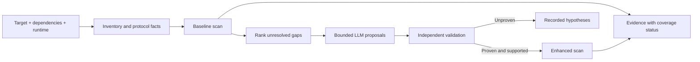

# Automatic taint configuration for Java deserialization

[Back to README](../README.md) · [Preparation command](#implemented-first-step) · [LLM enhancement](#adaptive-enhancement)

Design snapshot: 2026-10-31. Preparation with archive normalization, four experimental profiles, candidate triage against public gadget families and scanned-build mitigations, and a bounded wrapper-enhancement prototype are implemented. The prototype independently validates straight-line reference-return flow under reviewed baseline constructor contracts; it is not a general semantic validator. Protocol-aware boundary discovery, field/control-flow validation and the feedback loop described below remain **proposed work**.

The objective is to remove handwritten taint configuration while making every generated rule traceable to the target. Start with reusable API semantics, derive target-specific facts from bytecode, then ask an LLM about unresolved semantics. A successful configuration build is not evidence that a vulnerability exists or that the scan covers the application.

## Findings in the current implementation

| Finding | Consequence | Change |
| --- | --- | --- |
| The Gleipner knowledge file uses benchmark-specific sinks | It is not a general security profile | Keep benchmark reproduction separate; supply native API profiles |
| Its ignores include JNDI, RMI, networking, XML/XSLT and scripting packages | Relevant paths can disappear before the LLM sees them | No package-wide ignores in the new baseline |
| Flash's `serializable` selector recognizes only `readObject`, `readExternal`, and `readResolve` signatures | `readObjectNoData` is omitted; name matching alone is not callback eligibility | Generate exact callback signatures from class/interface metadata |
| Flash supports exact source signatures in the main configuration | Entry selection can be automated without changing its JAR | Emit explicit roots, including eligible `readObjectNoData` declarations |
| Knowledge YAML accepts `sinks`, `transfers`, `imitates`, `ignores`, `sanitizers` | Protocol events, guard order and compound sink conditions cannot be encoded faithfully in this format | Keep a richer rule/evidence representation and an explicit backend capability check |
| Invalid index strings can fall back to the receiver in the bundled parser | A typo can silently change a rule's meaning | Validate indices against actual method signatures before compilation |
| Missing knowledge methods are logged and skipped by Flash | A scan can look successful despite missing rules | Publish unresolved-rule and classpath coverage diagnostics |
| Rules can reference a class present on disk but not loaded into Flash's world | A metadata-resolved rule can still be skipped | Seed rule/callback owners through `inputClasses`; test actual backend loading |
| Flash processes transfer/dispatch rules before sink rules | A method cannot be both a nested-read transfer and a boundary sink | Nested reads are transfers so calls on the read object are followed; the `ObjectInputStream` constructor over controlled data is the secondary-deserialization boundary |
| With `prependJVM: false`, Flash looks in `java-benchmarks/JREs/jre1.8` relative to its working directory | A valid target and YAML can still fail to start | Preparation builds this layout using links to the supplied runtime |

Evidence: repository `gleipner_results/configs/Gleipner_baseline_priori-knowledge.yml`; `javap -p -c` inspection of `SootClassLoader`, `AbstractWorldBuilder`, `PrioriKnowConfig$Deserializer`, and `InvokeUtils` in the bundled JAR. The manifest fingerprints that JAR. This inspection is not a source-level audit of all Flash analysis semantics.

## What JDD contributes

Inspected upstream revision: [`5fbda8110dbc09fd7e36020923531f9a1cc3ae59`](https://github.com/fdu-sec/JDD/tree/5fbda8110dbc09fd7e36020923531f9a1cc3ae59). No JDD implementation has been copied into this repository.

| Code | Observed mechanism | Design implication |
| --- | --- | --- |
| [`JdkNativeProtocolCheckRule`](https://github.com/fdu-sec/JDD/blob/5fbda8110dbc09fd7e36020923531f9a1cc3ae59/src/jdd/rules/protocol/JdkNativeProtocolCheckRule.java) | Four native callback signatures; separate handling of equality triggers | Protocol roots and container-induced callbacks are different concepts |
| [`HessianProtocolCheckRule`](https://github.com/fdu-sec/JDD/blob/5fbda8110dbc09fd7e36020923531f9a1cc3ae59/src/jdd/rules/protocol/HessianProtocolCheckRule.java) | Uses implementations of `Map.put` as source candidates under its protocol model | Do not reuse native Serializable restrictions for every serializer |
| [`InputTaintGenerator`](https://github.com/fdu-sec/JDD/blob/5fbda8110dbc09fd7e36020923531f9a1cc3ae59/src/jdd/dataflow/InputTaintGenerator.java) and [`TaintSpreadRule`](https://github.com/fdu-sec/JDD/blob/5fbda8110dbc09fd7e36020923531f9a1cc3ae59/src/jdd/tranModel/Rules/TaintSpreadRule.java) | Receiver/parameter seeds and field access paths; array elements are collapsed | Track which object state is controllable, and expose precision loss |
| [`InvokeCheckRule`](https://github.com/fdu-sec/JDD/blob/5fbda8110dbc09fd7e36020923531f9a1cc3ae59/src/jdd/rules/sinks/InvokeCheckRule.java) | Checks Method/receiver taint and possible types | A reflective call needs target/receiver/argument conditions, not a universal RCE label |
| [`ClassLoaderCheckRule`](https://github.com/fdu-sec/JDD/blob/5fbda8110dbc09fd7e36020923531f9a1cc3ae59/src/jdd/rules/sinks/ClassLoaderCheckRule.java) | Tracks controlled class bytes, loaders and initialization conditions | Loading, initialization and invocation must remain distinct events |
| [`ExecCheckRule`](https://github.com/fdu-sec/JDD/blob/5fbda8110dbc09fd7e36020923531f9a1cc3ae59/src/jdd/rules/sinks/ExecCheckRule.java) | Includes Runtime execution, ProcessBuilder constructors and name-based heuristics | Useful candidates, but construction alone does not start a process |
| [`SearchGadgetChains`](https://github.com/fdu-sec/JDD/blob/5fbda8110dbc09fd7e36020923531f9a1cc3ae59/src/jdd/detetor/SearchGadgetChains.java) | Searches fragments, links free fragments toward sink requirements, then links source fragments; applies priority/heuristic filters | Reuse validated summaries at fragment boundaries, and measure what bounded linking omits |

These are research heuristics, not a correctness oracle. In particular, the new profile marks `ProcessBuilder.start()` as the effect boundary; constructor/command arguments propagate into builder state. Name matches such as `exec` or `deserialize` can prioritize inspection, but cannot establish method semantics.

## Requirements from recent disclosures

The following are design inputs from primary advisories, not claims that GadgetHunter detects these vulnerabilities today.

| Disclosure | Relevant behavior | Required model |
| --- | --- | --- |
| [Camel CVE-2026-40473, 2026-04-24](https://camel.apache.org/security/CVE-2026-40473.html) | A MINA converter creates an ObjectInputStream from network data; reading through the returned ObjectInput crosses the dangerous boundary | Track factory/converter returns, stream identity and the later read; do not stop at literal `new ObjectInputStream` searches |
| [Camel CVE-2026-88900, 2026-10-19](https://camel.apache.org/security/CVE-2026-88900.html) | JGroups can materialize an ObjectMessage on its receive thread before Camel examines the body; post-read checks cannot prevent earlier callbacks | Model library/lifecycle events and pre-read controls, not just sequential application call sites |
| [Jenkins CVE-2026-117612, 2026-10-28](https://www.jenkins.io/security/advisory/2026-10-28/) | A custom XStream converter omitted filtering for classes referenced by `resolves-to` | Check replacement-type coverage, custom converters and `readResolve` timing; a filter on the original type is insufficient |

For Camel-JGroups, the advisory distinguishes post-read checking in backports from mandatory pre-read controls in 4.23.0. Therefore a dependency version marked “fixed” is contextual evidence, not enough to prove a path blocked. For Jenkins, keep the neighboring collection-element type-check issue (CVE-2026-117613, with a documented stored-XSS impact) separate from the RCE issue. Do not turn every deserialization-related advisory into an RCE label.

## Two analyses that must stay separate

1. **Application exposure:** untrusted request/message/file bytes → decoding/conversion → deserializer event. Record authentication, transport access and deployment assumptions. A library JAR alone usually cannot establish this.
2. **Gadget reachability:** protocol callback → controlled state → calls and dispatch → dangerous effect. Library-only scans can report useful candidates without asserting a remotely reachable vulnerability.

Join these results only when the same protocol, classloader, dependency versions and runtime policy permit the object graph. Record each component as `established`, `refuted`, or `unknown`. Do not multiply guessed confidence scores into a “confirmed exploit” score.

Serialization does not automatically make every receiver field attacker-controlled. Native Java requires attention to static/transient fields, `serialPersistentFields`, custom `readObject`/`readExternal`, substitution, superclass initialization and the permitted object graph. Transient fields may become controlled through assignments during callbacks. Objects created *inside* callbacks may be non-Serializable helpers. Container callbacks (`hashCode`, `equals`, `compare`, `toString`) need a protocol/container trigger; they are not blanket roots.

## Rule layers and baseline scope

**L0: reviewed reusable semantics.** Versioned profiles express stable public APIs and protocol rules. **L1: deterministic target facts.** Resolve signatures, hierarchy, bytecode, runtime and wrappers where data flow is provable. **L2: adaptive proposals.** Use an LLM only for remaining gaps; preserve the evidence and validation status separately.

| Profile family | Rule intent | Initial status |
| --- | --- | --- |
| Native callbacks | Eligible `readObject`, `readObjectNoData`, `readExternal`, `readResolve`, `validateObject` declarations | Metadata-derived roots implemented for Java 8 |
| JDK propagation and ignores | Strings, builders, arrays, natives, decoders, stream wrappers; primitive leaf calls | `jdk-propagation`: transfers must be non-overridable and ignores pass a closed-world leaf proof on the scanned classpath |
| Process execution | Runtime command argument; ProcessBuilder command state reaching `start` | Coarse candidate sinks/transfers implemented |
| JNDI resolution | Controlled lookup name on Context/InitialContext | Candidate sinks implemented; provider/runtime effects remain unproven |
| Nested native deserialization | Objects read from the callback's stream are controlled; a new stream over controlled bytes is a boundary | Reads propagate (`readObject`/`readUnshared` base → result); `new ObjectInputStream(InputStream)` is the boundary, and helpers that build one from a parameter are derived boundaries |
| Reflection dispatch | Method.invoke / Constructor.newInstance receiver/argument mapping | Optional existing Flash approximation, not target feasibility proof |
| Reflection boundaries | Controlled Method/Constructor object, or a library-chosen method invoked on a controlled receiver | Added by `auto` when target code uses reflection; callable target and effect remain unproven |
| Class definition | Controlled bytes or URL list reaching `defineClass`, `Unsafe.defineAnonymousClass`, `URLClassLoader.newInstance` | Candidate sinks in `modern-effects`; initialization and invocation remain separate events. `Class.forName(..., false, ...)` is not construction |
| Expression / script evaluation | Parsed EL, SpEL, MVEL, Groovy or JSR-223 text reaching evaluation | Candidate sinks in `modern-effects`; parse methods propagate, evaluation is the boundary |
| JDBC connection | Controlled URL, properties or data source reaching a connection | Candidate sinks in `modern-effects`; driver-specific effects remain unproven |
| File/network effects | Controlled path/endpoint reaching write, rename, delete or an outbound request | Candidate sinks in `modern-effects`, triaged as separate effect families rather than RCE |
| Secondary deserializers | XMLDecoder, XStream, SnakeYAML, Hessian, fastjson entry points | Candidate boundaries in `modern-effects`; each needs its own protocol model |
| Hessian / XStream / JSON polymorphism as roots | Protocol-specific object creation, converters and callback triggers | Planned; require target dependency/configuration evidence |
| Guards | Stream/type policy and event ordering | Planned evidence model; no blanket taint-cleansing rule |

Public API semantics are more reusable than vendor-private JDK internals or lists of famous gadget classes. Applicability still depends on the actual method signature and runtime. JNDI lookup is not universally remote code execution; modern runtime/provider restrictions can change its effect. A tainted ProcessBuilder receiver is an approximation: the command field, not unrelated receiver state, must ultimately be controlled.

### Implemented first step

From the repository root, with Python dependencies installed:

```bash
python prepare_scan.py \
  --app /absolute/path/application.jar \
  --lib /absolute/path/dependency.jar \
  --java8-home /absolute/path/to/target-jdk8 \
  --output .gadgethunter/prepared/application
```

Repeat `--app`/`--lib` for additional JARs or class directories. The default profile is `native-core`. Add `--profile native-core --profile reflection-boundaries` to report controlled reflective-selection boundaries. The alternative `--profile native-core --profile reflection-dispatch` attempts target expansion and can substantially increase graph-construction cost. Boundary and dispatch profiles cannot be combined in one search because Flash would shadow the sink rules. See [reflection scope and limitations](usage.md#experimental-reflection-boundaries).

The command reads class metadata without loading target classes, validates profile indices against resolved declarations, and writes:

| File | Meaning |
| --- | --- |
| `config.yml` | Absolute classpaths, exact callback roots, Flash settings |
| `knowledge.yml` | Resolved built-in rules, with no package ignores or sanitizers |
| `manifest.json` | Profile/backend/class inventory hashes, origins, included/missing rules, unresolved hierarchy types and limitations |
| `java-benchmarks/JREs/jre1.8/*.jar` | Links to the supplied Java 8 runtime for Flash's expected layout |

Review the manifest, then invoke candidate generation with a supported JVM on PATH:

```bash
bash multi-agents/flash/run.sh /absolute/path/to/prepared/application/config.yml
```

The target runtime and the JVM running Flash are distinct. The prepared directory uses local absolute paths and must be regenerated after moving/changing inputs. It is a preparation snapshot, not an immutable run or a resume guarantee. Unresolved hierarchy types mean callback discovery may be incomplete. Runtime extension JARs must be passed explicitly if needed.

For preparation plus bounded execution, use [`scan_candidates.py`](usage.md#bounded-candidate-generation). It verifies that the backend actually loaded the resolved rules, exposes progress, and retains complete candidate blocks on timeout. Root selection and package coverage are unchanged.

Spring Boot and WAR layouts are split into application classes and nested libraries. Classes a Java 8 runtime cannot load (multi-release overlays, `module-info`, bytecode above 52) are dropped, and duplicates keep the first definition in classpath order; the manifest lists every such class instead of scanning the wrong one silently. Preparation does not launch a build tool or resolve remote dependencies. Modular (Java 9+) target runtimes remain a required milestone before broad deployment.

## From benchmark compatibility to review priority

The benchmark configuration was tuned to reproduce ysoserial-era chains: it ignored whole JDK packages and treated every route as equally interesting. On a patched runtime many of those routes are dead. For example, a patched Java 8 runtime closes these `AnnotationInvocationHandler` edges: `invoke` dispatching to an attacker-chosen `memberValues` map (rebuilt as a fresh `LinkedHashMap` since 8u71), `readObject` calling `setValue`, and `equalsImpl` on non-annotation types (rejected since 7u25).

The new profiles therefore keep those classes in the search, and [`rules/triage.yml`](../rules/triage.yml) moves the old knowledge to review time:

1. **Public families** identify rediscoveries. A chain is `known` only when it uses a family's core gadget; reusable triggers (`HashMap`, `PriorityQueue`, `BadAttributeValueExpException`, `XString`, `HotSwappableTargetSource`) and terminals (`TemplatesImpl`, `JdbcRowSetImpl`) do not make it known, because a new middle segment is exactly what a 0day looks like.
2. **Mitigations** cite evidence from the scanned classpath: a callback calling a guard (`FunctorUtils.checkUnsafeSerialization`), a declared `readResolve` (Groovy `MethodClosure`), a class that lost `Serializable` (Commons Collections 4.1 functors), or a runtime default (JNDI remote codebases on 8u191+). Bytecode evidence is preferred to version numbers because vendors backport fixes and libraries are shaded.
3. **Plausibility and noise**: routes needing three or more receivers that the stream cannot supply, runtime-only routes in a target scan, and callbacks that merely read their own stream rank lower. A callback whose bytecode constructs a new `ObjectInputStream` stays a secondary deserializer, which keeps SignedObject-style filter bypasses visible.

The same reasoning governs predefined ignores. Flash drops an ignored call and its edge, so an ignore is accepted only after a closed-world proof over the scanned classpath that the call returns a primitive and cannot reach overridable code, invokedynamic or reference state. `String.equals` passes; `String.contains` does not, because it calls `toString` on an argument the attacker may control.

Nothing is pruned. A pruning rule that is wrong for one vendor build loses a real chain silently; a ranking that is wrong costs a reviewer a few minutes. Catalog entries are data, so new public chains and fixes can be added without code changes.

### Nested reads

Earlier profiles made nested `readObject` calls boundary sinks. A sink ends a path, so calls a callback makes on the object it just read (`hashCode`, `compare`, C3P0's `IndirectlySerialized.getObject`) were never followed. Nested reads are now transfers, and the `ObjectInputStream` constructor over controlled data is the secondary-deserialization boundary, which also reports new streams built in a callback. The backend does not match the constructor boundary when a helper builds the stream from its own parameter, so preparation derives those helpers from bytecode instead: a method whose parameter reaches `new ObjectInputStream(...)` directly or through `ByteArrayInputStream`, `BufferedInputStream`, `DataInputStream` or a GZIP/Inflater stream becomes a boundary sink on that parameter. Typical matches are `SerializationUtils.deserialize`-style helpers. Wrappers that build such a stream are no longer summarized as transfers, because a transfer would hide the boundary.

## Adaptive enhancement

Two model-assisted paths exist. `--mode llm-gaps` targets what the search cannot see at all: abstract methods the target calls that have no implementation on the classpath (reported in `coverage_gaps`). The model classifies each as a sink with an effect family, a transfer, or neither. There is no body to verify, so accepted rules are hypotheses, applied only in a separate preparation and named on every candidate that relies on them. The wrapper path below proposes transfers that an independent validator must prove.

The first executable slice is [`enhance_scan.py`](usage.md#experimental-wrapper-enhancement). It ranks methods by stream/byte-array types, reads their actual bytecode, and creates a separate enhanced preparation. Deterministic inference is the default; an optional single LLM request proposes transfers subject to the same independent validator. The current method neighborhood is not a backend frontier.

The verifier checks the entire supported method body because Flash transfers replace normal body analysis. Only normal-return reference provenance, local copies/casts and exact reviewed stream constructors are supported. Effects, unknown calls, mutation, branches, handlers and overridable dispatch prevent acceptance. The proof is relative to the existing constructor transfers, not a claim of constructor purity or complete JVM semantics. Original configurations and baseline findings are preserved. Accepted rules carry body/class hashes and proof traces; runtime launch rechecks the enhanced configuration and target inventory.

Real-backend regression compares separate baseline/enhanced searches with harmless compile-only fixtures. Both must retain command-effect candidates; a wrapper containing a command effect must never become a transfer that suppresses that effect. These scoped checks do not establish detection quality or performance across applications.

### Inputs and gap selection

Build a shared bytecode/source index with method signatures, flags, fields, call sites, dispatch candidates, source ranges and artifact hashes. Recover Maven coordinates from embedded metadata when available, but use content hashes as identity; shaded/forked code may invalidate version-based assumptions. Record source/binary mismatch and missing bodies.

Run the baseline first. Extract gaps from paths between protocol roots and effect boundaries: unresolved wrapper summaries, native/phantom methods, serializer factories, dynamic dispatch and guard policy. Rank by reachable frontier, relevance to a known boundary, reusable fan-out and estimated analysis cost. Do not send the whole repository or every method to the model.

Initially, until Flash exposes frontier events, select gaps from static wrapper neighborhoods. Mark this as a weaker approximation; current logs do not provide a complete unresolved-dataflow frontier. A bridge that exports analyzed IR and unresolved edges through backend APIs, or a rebuild from matching backend source, is required for the stronger feedback loop. Class metadata alone cannot certify a propagation summary.



### Proposal contract

The model returns constrained JSON, never arbitrary YAML, Python, shell commands or executable queries. A proposal references existing method and evidence IDs supplied by the index. Example of the **planned** representation:

```json
{
  "schema_version": 1,
  "kind": "transfer",
  "method_id": "method-184",
  "from": {"kind": "argument", "index": 0},
  "to": {"kind": "return"},
  "taint_kind": "serialized_bytes",
  "requires": [],
  "evidence_ids": ["instruction-81", "instruction-85"],
  "unknowns": []
}
```

The index binds these IDs to a content-addressed artifact and exact signature. The schema also needs typed variants for `boundary`, `dispatch`, `effect` and `guard_observation`; a generic transfer does not represent them. Keep object/type control, serialized bytes, class names and command/path values distinct. Field paths and collection-element summaries need explicit precision labels.

A wrapper example must prove the argument reaches the returned stream or deserialize result. A method that returns a constant, discards its argument, or invokes an unrelated deserializer is a negative example. A recognized method name is insufficient evidence.

### Acceptance pipeline

| Gate | Check | Failure outcome |
| --- | --- | --- |
| Schema | Allowlisted kind/fields, bounded sizes, valid IDs, no invented methods | Reject proposal |
| Resolution | Exact overload, parameter count/types, static/instance receiver, artifact/JDK applicability | Reject or leave unresolved |
| Evidence | Referenced code exists and hashes match; instructions belong to the proposed method/context | Reject stale/fabricated evidence |
| Semantic validation | Independently derive the claimed relation from bytecode/IR, including control flow and relevant aliases | Keep as hypothesis if unproven; schema validity is not semantic proof |
| Backend capability | Preserve all required conditions and taint kinds during lowering | Unsupported; do not erase conditions to make YAML compile |
| Differential regression | Positive/negative microcases, baseline-path preservation and cost measurement | Quarantine regression; retain baseline result |

LLM agreement and model confidence are ranking signals, not proof. A second LLM saying “correct” is not an independent data-flow validator. An unproven hypothesis may enable a separately labeled exploratory run, but its findings retain that provenance and do not enter the accepted rule cache.

The first adaptive release should add only proven transfer/wrapper rules. New sinks require effect classification; reflection edges require compatible signatures and receiver/argument mapping. Automatic ignores, sanitizers and global rule deletion remain disabled. Model-observed guards attach evidence without pruning paths.

### Guard semantics

A guard observation must include the protected stream/object, checked types, policy, installation/check event, controlled deserialization event, and configuration source. A blocking claim requires evidence that the relevant rejection occurs before the dangerous callback and covers the candidate types. Aliases, nested deserializers, replacement types, custom converters and bypass flags can invalidate that claim.

For JDK filters, account for the effective combination of process-wide, stream-specific and factory-provided policies, including undecided outcomes. The presence of `setObjectInputFilter` is not a sanitizer. Authentication narrows who can supply data; it does not cleanse that data. A cast or type check *after* deserialization does not prevent earlier callbacks. See Oracle's [serialization filtering documentation](https://docs.oracle.com/en/java/javase/11/core/serialization-filtering1.html).

### Bounded feedback and reproducibility

Proposed initial defaults, subject to measurement: at most two enhancement rounds, 30 selected gaps per run, 20,000 input/output tokens in total, and 100 accepted new rules. Enforce request timeouts, per-provider concurrency and an overall wall-time limit. If a single method cannot fit, record it as deferred rather than silently clipping evidence. Never improve latency by reporting an incomplete scan as clean.

Run baseline and enhanced configurations separately and retain the union of candidate evidence. Adding rules can change search order, consume budgets and trigger heuristic pruning; it does **not** guarantee monotonic recall in a bounded backend. If enhanced cost exceeds its cap, retain baseline results and label enhancement partial.

Cache keys include dependency/JDK hashes, method/body and neighborhood hashes, profile/schema/backend/validator versions, model ID, prompt hash and sampling parameters. Revalidate across versions. Keep proposals, rejected reasons, proof traces, accepted diffs and rule-to-finding provenance. Project-specific speculative rules never become global defaults automatically. Treat repository comments/documents as untrusted model input, with no tool execution authority.

## Evaluation and delivery order

1. **Preparation:** finish inventory coverage and runtime adapters; verify generated knowledge in the actual backend. Report resolved/unsupported rules and selected roots. The implemented preparation currently supports Java 8.
2. **Deterministic summaries:** straight-line stream factories and reference wrappers now have positive/negative bytecode tests. Extend the narrow proof model to fields and control flow, with a richer rule IR and explicit backend capability checks.
3. **Adaptive proposals:** one bounded request, strict proposal gates and isolated enhanced preparations are implemented. Backend-frontier ranking, a validated proposal cache and iterative feedback remain outstanding. Compare against both built-in-only and deterministic-only baselines.
4. **Protocol and guard plugins:** native policy first, then version-specific XStream/Hessian and message-library lifecycles. Preserve unknown configuration as unknown.
5. **Web integration:** the local form accepts JARs, fat JARs and WARs, lets each job choose effect coverage, runs baseline/enhanced searches, shows inventory/coverage diagnostics and the triage review list, and passes cluster representatives to source analysis by default. Multi-runtime selection remains outstanding.
6. **Catalog growth:** add public families and evidence-backed mitigations as they are disclosed, with a microcase per entry. Catalog changes alter the review order recorded in `triage.json` by hash, never the candidate set.

Tests should include private/static/inherited callbacks, transient/custom-read state, a tainted builder with a constant command, wrapper returns that drop input, reflection with a constant safe target, unresolved methods, pre-read rejection versus post-read casts, replacement types, and a fresh stream that lacks the original stream's policy. Test serial filters with harmless marker objects; no command execution or network callbacks are needed.

Current validation includes a real Corretto 8 runtime and the bundled Flash loader. The integration probe checks that all 14 sinks, 24 transfers and two optional dispatch mappings load, and that the fixture's `readObjectNoData` becomes a registered entry. It does not run candidate search or measure detection quality. Run it with a JDK 17+ compiler/runtime on PATH:

```bash
GADGETHUNTER_TEST_JAVA8_HOME=/path/to/target-jdk8 \
  python -m unittest discover -s tests -p test_scan_rules.py -v
```

Without that environment variable the real-runtime probe is skipped; the other preparation tests run when a suitable `javac` is available.

Use vulnerable/fixed release pairs from primary disclosures, with their documented configurations, plus held-out projects and dependency families. A fixed version is not automatically a negative example if its protection needs deployment settings. Keep all versions of one project in one split. Measure effect-specific recall, precision on independently labeled results, unknown rate, coverage, candidate count, p50/p95 wall time, peak memory, model calls/tokens/cost, and accepted-rule precision. Count timeout/partial scans explicitly.

Implementation references include [IRIS](https://proceedings.iclr.cc/paper_files/paper/2025/hash/582d4e27fa24168f3af1f4582655034b-Abstract-Conference.html) for taint specification inference and [SemTaint](https://arxiv.org/abs/2601.10865) for library summaries and unresolved call edges. Their abstractions are not assumed suitable for deserialization. The product goal is useful findings with less setup and predictable cost: prioritize protocol-specific control, lifecycle and guard semantics, and measure whether each enhancement helps users. Publication novelty is not an acceptance criterion. Validate historical cases and prospective findings separately so users can judge actual detection capability.
