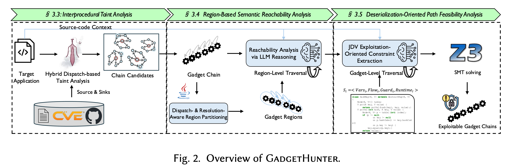

# Research artifact

[Back to README](../README.md)

## Paper and citation

> Kaixuan Li, Jian Zhang, Chong Wang, Sen Chen, Zong Cao, Min Zhang, Yang Liu.
> **GadgetHunter: Region-Based Neuro-symbolic Detection of Java Deserialization Vulnerabilities.**
> *Proc. ACM Softw. Eng.* 3, FSE, Article FSE003 (July 2026), 22 pages.
> [doi:10.1145/3797065](https://doi.org/10.1145/3797065)

Preprint version is vendored [**here**](../paper/kaixuan-FSE26_GadgetHunter.pdf).

<details><summary>BibTeX</summary>

```bibtex
@article{li2026gadgethunter,
  author    = {Li, Kaixuan and Zhang, Jian and Wang, Chong and Chen, Sen and
               Cao, Zong and Zhang, Min and Liu, Yang},
  title     = {{GadgetHunter}: Region-Based Neuro-symbolic Detection of
               {Java} Deserialization Vulnerabilities},
  journal   = {Proc. ACM Softw. Eng.},
  volume    = {3},
  number    = {FSE},
  articleno = {FSE003},
  numpages  = {22},
  year      = {2026},
  month     = jul,
  publisher = {Association for Computing Machinery},
  doi       = {10.1145/3797065}
}
```

</details>

## Analysis pipeline

GadgetHunter detects Java deserialization gadget chains in three stages:

1. **Stage 1 — Static taint analysis** (Tai-e) over-approximates candidate chains.
2. **Stage 2 — Region-based semantic reachability** partitions each chain at dynamic boundaries (reflection, polymorphic dispatch) and queries an LLM oracle.
3. **Stage 3 — Path feasibility** lifts each surviving chain to ⟨Vars, Flow, Guard, Runtime⟩ constraints and discharges them with Z3.



Phase A = Stage 1 (Java). Phase B = Stages 2–3 (Python multi-agent stack).

| Stage | Paper § | Entry point |
| --- | --- | --- |
| Stage 1 — interprocedural taint analysis, producing the over-approximated candidate set | §3.3 | `multi-agents/flash/` (modified backend, see below), `multi-agents/tools/runners/flash_runner.py` |
| Stage 2 — region partitioning (Algorithm 1) and LLM semantic reachability | §3.4 | `multi-agents/agents/region_analyzer_agent.py`, `multi-agents/agents/semantic_reachability_agent.py` |
| Stage 3 — constraint extraction and SMT path feasibility | §3.5 | `multi-agents/agents/path_constraint_agent.py`, `multi-agents/templates/z3_translator_template.py` |

`multi-agents/agents/region_based_coordinator.py` wires the three stages together and emits the
per-chain verdict.

**The Stage-1 backend is a modified Flash.** As described in §4, GadgetHunter's taint analysis
module is customized from Flash (Zhang et al., *Precise and Effective Gadget Chain Mining through
Deserialization Guided Call Graph Construction*, USENIX Security '25), whose backend is
[Tai-e](https://github.com/pascal-lab/Tai-e). We modified Flash so that each edge of an emitted
candidate chain also carries the JVM-level information the LLM module consumes in Stage 2 — the
call instruction kind (`[STATIC]`, `[SPECIAL]`, `[VIRTUAL]`, `[INTERFACE]`, `[DYNAMIC]`), which
drives the region partitioning policy of Table 2, together with the call-site line number and the
taint annotations for the receiver and parameters. `multi-agents/flash/flash.jar` is that modified build, which is why it is
vendored here rather than fetched from upstream. Chains are emitted in the form:

```
[INTERFACE] <Caller: sig> --(line:725, constraint:[0, 0, -3, -3])--> <Callee: sig>
```

For the taint configuration itself (sources, sinks, transfers), use Flash's, extended with the
deserialization-specific entries listed in Table 1 of the paper.

## Experiment settings

Per §4: GPT-4.1 as the LLM backend at temperature 0.2, Z3 with at most three repair iterations,
Java 8 targets, and three repetitions averaged in every reported table. Experiments ran on an Intel
Xeon Gold 6248 @ 2.50 GHz with 188 GB RAM under Ubuntu 22.04.

## Gleipner benchmark (Table 5)

These are the paper's reported results; they have not been rerun with the current engine changes.

`gleipner_results/` holds the run configurations and Stage-1 outputs for the three Gleipner
categories. GadgetHunter detects 14/20 Depth, 13/20 Polymorphism, and 1/10 Multipath cases.
The Multipath gap is a structural limitation of method-summary-based taint analysis, discussed in
§5.2.2: several distinct paths collapse into one chain after summarisation. Extending the path
collection budget recovers 16/20 Depth and 15/20 Polymorphism, which confirms that the Depth and
Polymorphism gaps come from configuration trade-offs inherited from Flash rather than from the
approach itself.

## Available data

- [Gleipner configurations and Stage-1 outputs](../gleipner_results/)
- [Benchmark configuration notes](../gleipner_results/analysis.md)
- [Figure data and plotting instructions](../analysis_scripts/README.md)

The per-chain traces for the 22 ysoserial applications (~1.4 GB of LLM I/O
and generated Z3 scripts) are distributed separately and are not included here.
